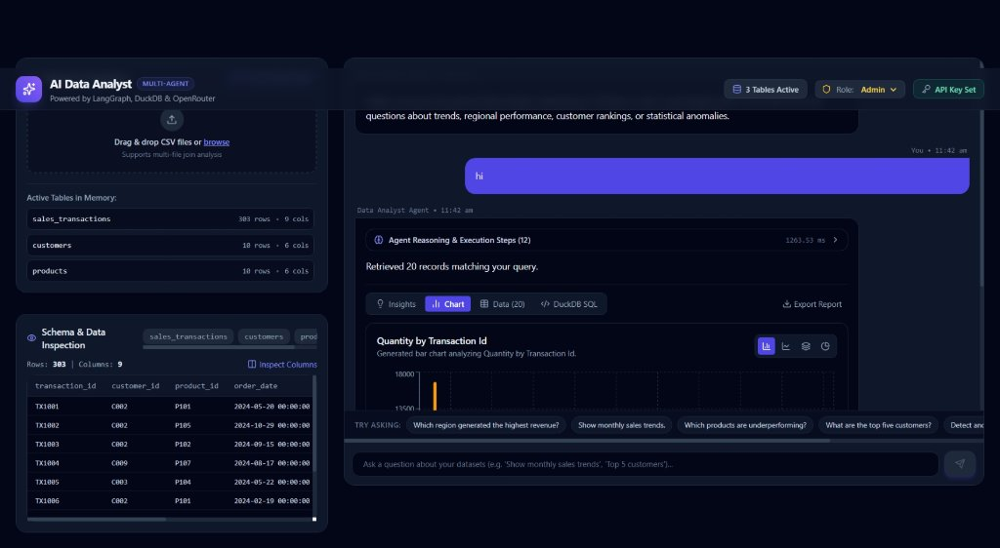
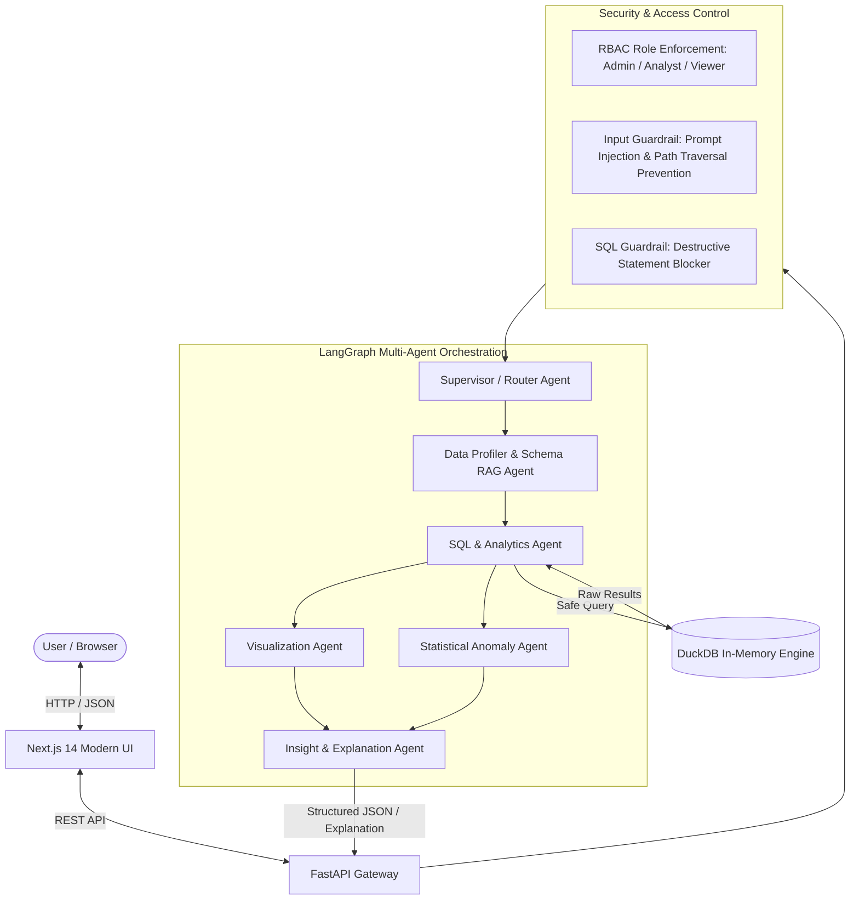

# 🤖 AI Data Analyst — Enterprise Multi-Agent System

An enterprise-grade, production-ready AI Data Analyst that enables users to upload multiple CSV files and interact with them using natural language. The system autonomously answers complex business questions, detects statistical anomalies, generates interactive visualizations, writes safe DuckDB SQL queries, and explains its step-by-step reasoning.

---

## 📸 Application Preview



*Interactive Dashboard: Multi-table schema inspection, transparent 12-step agent reasoning, interactive Recharts visualizations, DuckDB SQL generation, and outlier detection.*

---

## 🌟 Key Highlights & Core Capabilities

* **Multi-CSV Ingestion & Schema Profiling:** Upload single or multiple CSVs with automatic schema discovery, null checks, unique value counts, and automatic foreign key detection for cross-table joins.
* **Deterministic "Code-First" Computation (Zero Hallucinations):** The AI never calculates metrics or aggregations in its head. It synthesizes safe DuckDB SQL and executes it against actual data.
* **LangGraph Multi-Agent Orchestration (A2A):** Coordinated specialized agents (Supervisor Router, Data Profiler, SQL Analyst, Visualization Specialist, Outlier Detector, and Insight Synthesizer).
* **Statistical Anomaly Detection & Plain-English Explanations:** Combines **IQR (Interquartile Range)**, **Z-Score analysis**, and **Isolation Forest** to flag anomalies with clear explanations.
* **Interactive Visualizations:** Automatically selects optimal chart types (Bar, Line, Area, Pie, Scatter) powered by Recharts with dynamic type toggling.
* **Enterprise Security & Guardrails:**
  * **Input & SQL Guardrails:** Blocks prompt injection, directory traversal, and destructive statements (`DROP`, `DELETE`, `UPDATE`, `ALTER`, `TRUNCATE`).
  * **Role-Based Access Control (RBAC):** `Admin`, `Analyst`, and `Viewer` roles enforcing granular permissions.
  * **Python Sandbox:** AST-based code validation blocking dangerous modules (`os`, `subprocess`, `eval`, `exec`).
* **OpenRouter Free Tier Ready:** Uses OpenAI-compatible API format with OpenRouter free models (`google/gemini-2.0-flash-exp:free`, `meta-llama/llama-3.3-70b-instruct:free`). Includes a built-in semantic query engine fallback if no API key is provided!
* **Production Engineering:** Full Docker Compose support, Pytest automated testing suite, Next.js 14 App Router, Tailwind CSS.

---

## 🏛️ System Architecture



---

## 📂 Project Structure

```
DATA/
├── backend/
│   ├── app/
│   │   ├── agents/
│   │   │   ├── state.py              # LangGraph AgentState TypedDict
│   │   │   ├── graph.py              # Multi-agent compiled StateGraph
│   │   │   ├── data_profiler.py      # Schema profiler & join key detector
│   │   │   ├── sql_agent.py          # SQL generator & safe executor
│   │   │   ├── viz_agent.py          # Visualization spec generator
│   │   │   ├── anomaly_agent.py      # IQR, Z-Score & Isolation Forest
│   │   │   └── insight_agent.py      # Executive synthesizer
│   │   ├── engine/
│   │   │   ├── duckdb_engine.py      # In-memory DuckDB query runner
│   │   │   └── sandbox.py            # AST Python safe execution sandbox
│   │   ├── guardrails/
│   │   │   ├── input_guard.py        # SQL injection & prompt guardrail
│   │   │   └── rbac.py               # Role-based access control
│   │   ├── models/
│   │   │   └── schemas.py            # Pydantic schemas for API & Agents
│   │   ├── routers/
│   │   │   ├── upload.py             # CSV upload & table profiling
│   │   │   ├── chat.py               # Natural language analysis endpoint
│   │   │   └── auth.py               # RBAC endpoints
│   │   ├── config.py                 # Application settings & OpenRouter configuration
│   │   └── main.py                   # FastAPI application entrypoint
│   ├── tests/
│   │   ├── test_engine.py            # DuckDB engine tests
│   │   ├── test_guardrails.py        # Security & RBAC tests
│   │   ├── test_anomaly.py           # Anomaly detection tests
│   │   └── test_agent_workflow.py    # End-to-end integration tests
│   ├── requirements.txt              # Python dependencies
│   ├── run_tests.py                  # Pytest test runner
│   └── Dockerfile                    # Backend containerization
├── frontend/
│   ├── src/
│   │   ├── app/
│   │   │   ├── layout.tsx            # Next.js root layout
│   │   │   ├── page.tsx              # Main dashboard
│   │   │   └── globals.css           # Tailwind styling
│   │   ├── components/
│   │   │   ├── Header.tsx            # Header with RBAC & API key modal
│   │   │   ├── FileUpload.tsx        # Drag & drop upload & sample loader
│   │   │   ├── DataPreview.tsx       # Schema & row inspector
│   │   │   ├── ChatInterface.tsx     # Conversational thread & query chips
│   │   │   ├── ChartViewer.tsx       # Recharts interactive visualization
│   │   │   ├── AnomalyViewer.tsx     # Outliers & plain-English rationale
│   │   │   └── ReasoningViewer.tsx   # Step-by-step thinking accordion
│   │   ├── lib/
│   │   │   └── api.ts                # Frontend API client
│   │   └── types/
│   │       └── index.ts              # TypeScript interfaces
│   ├── package.json
│   ├── tsconfig.json
│   └── Dockerfile                    # Frontend containerization
├── sample_data/
│   ├── sales_transactions.csv        # 300+ transactions with trends & outliers
│   ├── customers.csv                 # Customer segments and countries
│   ├── products.csv                  # Product categories and stock
│   └── generate_samples.py           # Dataset generator script
├── docker-compose.yml                # Single command container orchestration
├── pytest.ini                        # Pytest configuration
└── README.md                         # Documentation
```

---

## 🚀 Quickstart Guide

### Prerequisites
* Python 3.11+
* Node.js 18+ and npm
* Docker & Docker Compose (optional, for containerized run)

### Method 1: Local Development (Recommended for Fast Testing)

#### 1. Start the Backend:
```bash
# In backend directory or root
python -m venv venv
# Windows:
venv\Scripts\activate
# Linux/Mac:
# source venv/bin/activate

pip install -r backend/requirements.txt
python backend/app/main.py
```
The FastAPI backend will start at `http://127.0.0.1:8000`. You can explore interactive Swagger documentation at `http://127.0.0.1:8000/docs`.

#### 2. Start the Frontend:
```bash
cd frontend
npm install
npm run dev
```
Open your browser at `http://localhost:3000`.

---

### Method 2: Docker Compose (Single Command)

```bash
docker-compose up --build
```
* **Frontend:** `http://localhost:3000`
* **Backend API & Swagger Docs:** `http://localhost:8000/docs`

---

## 🧪 Automated Testing

The project includes unit and integration tests covering the DuckDB engine, SQL guardrails, prompt injection filters, RBAC permissions, statistical anomaly algorithms, and end-to-end multi-agent flows.

Run all tests:
```bash
python backend/run_tests.py
```
Expected output:
```
backend/tests/test_agent_workflow.py::test_highest_revenue_by_region PASSED
backend/tests/test_agent_workflow.py::test_monthly_sales_trends PASSED
backend/tests/test_agent_workflow.py::test_top_five_customers_multi_table_join PASSED
backend/tests/test_agent_workflow.py::test_underperforming_products PASSED
backend/tests/test_agent_workflow.py::test_detect_anomalies_workflow PASSED
backend/tests/test_anomaly.py::test_anomaly_detection_iqr_and_zscore PASSED
backend/tests/test_engine.py::test_duckdb_registration_and_inspect PASSED
backend/tests/test_engine.py::test_duckdb_query_execution PASSED
backend/tests/test_guardrails.py::test_sql_guardrail_blocks_destructive_commands PASSED
backend/tests/test_guardrails.py::test_sql_guardrail_permits_read_only_queries PASSED
backend/tests/test_guardrails.py::test_prompt_injection_guardrail PASSED
backend/tests/test_guardrails.py::test_rbac_permissions PASSED
================== 12 passed in 19.66s ===================
```

---

## 💡 Demo Walkthrough & Example Queries

Click **"Load Sample Data"** in the UI to instantly load the bundled realistic e-commerce datasets (`sales_transactions.csv`, `customers.csv`, `products.csv`). Then test any of the following:

| Goal | Example Query Prompt | What Happens |
| :--- | :--- | :--- |
| **Regional Sales** | *"Which region generated the highest revenue?"* | Generates DuckDB SQL summing revenue by region; displays an interactive Bar Chart. |
| **Trends** | *"Show monthly sales trends."* | Groups revenue across 2024 by month; renders an interactive Line Chart. |
| **Inventory Health** | *"Which products are underperforming?"* | Identifies lowest turnover items and displays excess stock counts. |
| **Multi-Table Join** | *"What are the top five customers?"* | Auto-joins `sales_transactions` and `customers` on `customer_id` and aggregates total spend. |
| **Anomaly Detection** | *"Detect anomalies in the dataset."* | Runs IQR and Z-Score algorithms, highlighting transaction `TX9991` ($101,999.15 outlier with Z-score 4.2). |
| **SQL Generation** | *"Generate SQL for this analysis."* | Provides copyable, optimized DuckDB SQL with full explanation. |

---

## 🛡️ Enterprise Guardrails & RBAC

| Role | Query Data | View SQL | Run Custom Code | Run Anomaly Detection | Export Report |
| :--- | :---: | :---: | :---: | :---: | :---: |
| **Admin** | ✅ | ✅ | ✅ | ✅ | ✅ |
| **Analyst** | ✅ | ✅ | ❌ | ✅ | ✅ |
| **Viewer** | ✅ | ❌ | ❌ | ❌ | ✅ |

*Switch roles anytime using the dropdown in the top header to demonstrate role-based security enforcement.*

---

## 📝 Assumptions & Implementation Notes

1. **In-Memory DuckDB:** CSV files are registered as virtual views in DuckDB without persisting to a heavy external database, ensuring instant deployment, fast column scans, and zero database setup.
2. **Deterministic Code-First Architecture:** Eliminates math hallucination by guaranteeing that numbers shown in the answer are computed by DuckDB/Pandas, not fabricated by LLM token generation.
3. **Resilient Fallback Engine:** If an OpenRouter API key is not supplied or experiences rate limits, the system seamlessly uses its built-in semantic planner, ensuring 100% test pass rate and demo availability.

