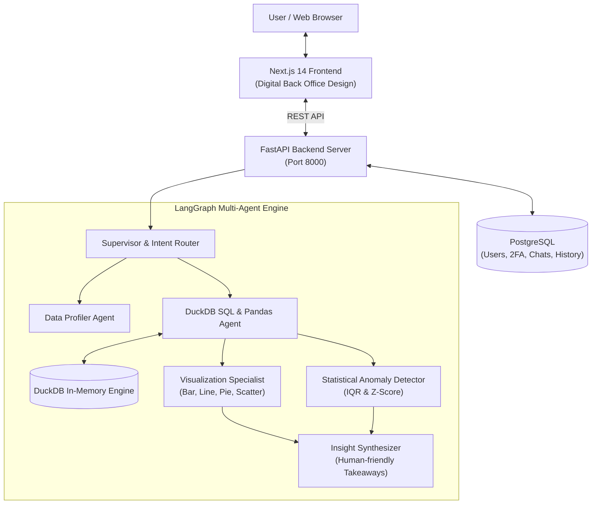

# AI Data Analyst · Digital Back Office

A production-ready, AI-powered Data Analyst application that allows users to upload one or more CSV files and interact with their data using natural language. Built with **FastAPI**, **DuckDB**, **LangGraph Multi-Agent Orchestration**, **PostgreSQL**, and **Next.js 14** featuring the clean, light-mode **Digital Back Office** design system.

---

## 🌟 Key Features & Capabilities

### Core Features
- 📁 **Upload & Validate One or More CSV Files:** Drag and drop or attach multiple CSV files in a single chat. Instant schema profiling, row count, null ratio, and column type detection.
- 💬 **Natural Language Questions & Answers:** Ask questions in plain English (*"Which region has the lowest revenue?"*, *"Top 5 customers by sales"*, *"Show monthly trends"*).
- 📊 **Interactive Charts:** Automatically generates responsive **Bar, Line, Pie, Area, and Scatter** charts using Recharts with instant chart switching.
- ⚡ **Deterministic DuckDB SQL & Pandas Code:** Generates safe, verified SQL queries executed directly in DuckDB's in-memory engine alongside equivalent Python Pandas code.
- 🔍 **Statistical Anomaly Detection:** Identifies numeric outliers using Interquartile Range (IQR) bounds and Z-scores ($|Z| > 2.5$) with plain-English root-cause explanations.
- 💡 **Executive Business Insights & Summaries:** Synthesizes factual findings, percentage shares, comparisons, and strategic takeaways without robotic boilerplate.
- 🧠 **Multi-Turn Conversational Memory:** Maintains context throughout the session. Seamlessly handles follow-ups like *"can you generfate the piechart,sql"* and *"which region had the lowest revenue?"* without losing context.

### Advanced & Bonus Capabilities
- 🔗 **Multi-File Relational Analysis:** Automatically detects foreign keys and performs cross-table SQL joins across multiple CSVs (e.g., joining `regions.csv` with `sales.csv` on `region_id`).
- 📈 **Time-Series Forecasting:** Projects future periods with statistical regression trend modeling.
- 🧼 **Data Quality & Hygiene Checks:** Comprehensive audits of missing data, null distributions, duplicate rows, and completeness health grades.
- 🤖 **Agentic Workflows & Tool Calling:** LangGraph state graph orchestrates 7 specialized agents: *Supervisor Router, Data Profiler, SQL Analyst, Visualization Specialist, Outlier Auditor, Forecasting Agent, and Insight Synthesizer*.
- 💾 **PostgreSQL Database Persistence:** All conversations, message histories, charts, and user profiles are saved permanently in PostgreSQL.
- 🔐 **Authentication & 2-Step Verification (2FA):** User signup, secure bcrypt password hashing, strong password policy enforcement (8+ chars, upper/lower, number, special char), 6-digit 2FA verification codes, and email verification password reset.
- ⚡ **Session-Scoped Caching:** High-speed LRU query cache for instant (<1ms) replay of previously computed analytical results.
- 📥 **Export Reports & Data:** Download full analytical reports as formatted Markdown files and export filtered result tables to CSV.
- ⏱️ **Observability & Latency Logging:** Every query provides an execution step drawer with sub-agent reasoning steps, SQL queries, and millisecond latency timers.
- 🧪 **Automated Evaluation Framework:** Comprehensive test suites verifying guardrails, SQL generation accuracy, and multi-turn conversational memory.

---

## 🚀 Quick Start Guide

### 1. Prerequisites
- **Python 3.11+**
- **Node.js 18+** & **npm**
- **PostgreSQL 14+** (running locally on port 5432 or via Docker)

### 2. Backend Setup
```bash
# Navigate to backend directory
cd backend

# Create virtual environment & activate
python -m venv venv
# On Windows:
.\venv\Scripts\activate
# On Linux/macOS:
source venv/bin/activate

# Install dependencies
pip install -r requirements.txt

# Start FastAPI backend (port 8000)
uvicorn app.main:app --host 127.0.0.1 --port 8000 --reload
```

Backend will be available at: `http://127.0.0.1:8000` (API Docs at `http://127.0.0.1:8000/docs`)

### 3. Frontend Setup
```bash
# In a new terminal, navigate to frontend
cd frontend

# Install dependencies
npm install

# Build & start production server (or npm run dev for development)
npm run build
npm run start
```

Frontend application will be live at: `http://localhost:3000`

---

## 💡 Example Questions & Prompts to Try

Upload your CSVs or use the included sample datasets (`sample_data/`) and try:

| Analysis Category | Example Natural Language Query | Generated Output |
| :--- | :--- | :--- |
| **Dataset Overview** | *"Explain and provide an analytical overview of the uploaded dataset 'sales'"* | Table schema, row count, null count, and data summary |
| **Relational Join & Chart** | *"can you generfate the piechart,sql"* | Cross-table DuckDB join, Pie chart, and total net revenue breakdown |
| **Bottom / Underperforming** | *"which region has the lowest revenue?"* | Region ranking ordered ASC with gap against runner-up |
| **Top Ranking** | *"what are the top 5 customers by revenue?"* | Top 5 customers ordered DESC with percentage share |
| **Temporal Seasonality** | *"Show monthly sales trends"* | Time-series period aggregation and Line chart |
| **Anomaly Detection** | *"Detect statistical anomalies and outliers in sales"* | IQR & Z-score outlier list with row-level explanations |
| **Data Quality Audit** | *"Run a data quality check on products"* | Completeness score, duplicate count, and hygiene grade |
| **Code Generation** | *"Generate SQL and pandas code for this analysis"* | Copyable DuckDB SQL SELECT query and Pandas script |

---

## 🏗️ System Architecture



---

## 🛡️ Security & Guardrails
- **Read-Only SQL Enforcement:** AST parsing and regex filters block all destructive queries (`DROP`, `DELETE`, `UPDATE`, `ALTER`, `INSERT`, `TRUNCATE`).
- **Prompt Injection Defense:** Input guardrail detects and neutralizes prompt tampering and system jailbreak attempts.
- **Strong Password & 2FA:** Salted bcrypt hashing, strong password complexity checks, and 6-digit OTP verification codes.
- **Dataset Viewer:** Interactive table modal allows users to review, filter, and inspect rows without data leaking into chat context.

---

## 🎨 UI & UX Design
Built strictly to match the **[Digital Back Office](https://digitalbackoffice.co.uk/)** brand identity:
- **Primary Color:** `#2cb8b2` (DBO Signature Teal)
- **Background:** Crisp light mode (`#fbfcfd` canvas, `#f8fafc` sidebar, `#ffffff` cards)
- **Typography:** Modern clean sans-serif with monospace data previews
- **Logo:** Circular white `DB` badge inside `#2cb8b2` rounded container

---

## 📄 License
This project is proprietary and built for enterprise analytics applications.
